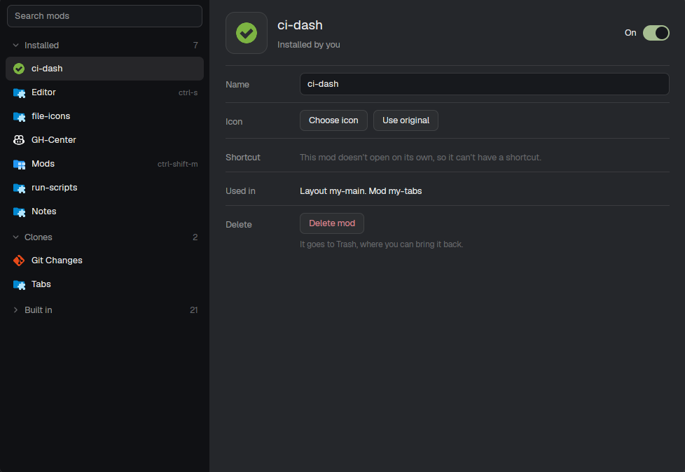

# Mod Manager for Herdr

One place for every [Herdr](https://herdr.dev) mod: turn mods off and on, delete the ones you installed, and give any mod your own name, icon and shortcut.



## Features

- Mods grouped as **Installed**, **Clones**, **Trash** and **Built in** (last, folded). Each group folds; a search field filters them all.
- **Turn off / on** any mod, built-in ones too. Herdr has no "off" switch, so turning off takes the mod's blocks out of your layouts and its keys out of `keys.json`, and remembers both to put them back.
- **Delete** mods you installed: they go to Trash, from where you can restore them or delete them for good.
- **Name and icon**: rename any mod and pick one of 66 preset icons.
- **Shortcut**: give a mod a key. If the key is taken, it says which mod or command loses it, and warns about keys terminal programs need (ctrl+c, ctrl+d…).
- Before turning off or deleting, it lists what changes: the layouts it leaves, the mods that use it, the keys it loses.
- Every write is checked with `herdr-app status`; if Herdr reports a new error, the change is undone.

## Install

Ask your Herdr agent:

> Read ~/.config/herdr-app/AGENTS.md, then add this mod: https://github.com/mattsandovalb/herdr-mod-manager

Or by hand: copy `mods/mod-manager` into `~/.config/herdr-app/mods/` and merge `keys.json` into yours. Open it with `ctrl-shift-m` or:

```sh
herdr-app do mod.open --name mod-manager
```

## What it touches

- Edits your own `layouts/*.json` and `keys.json`. Herdr's shipped layouts are never edited.
- Moves turned-off mods you installed to `~/.config/herdr-app/mod-manager/disabled/`, deleted ones to `~/.config/herdr-app/mod-manager/trash/`. "Delete for good" runs `rm -rf` on that one folder.
- Runs `ls`, `grep`, `mkdir`, `mv`, `rm`, `sleep`, `herdr-app status` and `herdr-app check`. No network.

## Names and icons in other mods

Names and icons are stored in shared state, so your own bars and lists can show them:

```js
const label = (shared("mod-manager.labels") ?? {})["files"] ?? {}; // { name?, icon? }
```

## Shortcuts

A mod with an overlay opens with `mod.open`. A mod in a layout block gets `layout.toggle` on that block. Mods inside a stack, or with no block, can't have a shortcut.

## License

MIT. Icons in `icons/` from Material Icon Theme (MIT).
