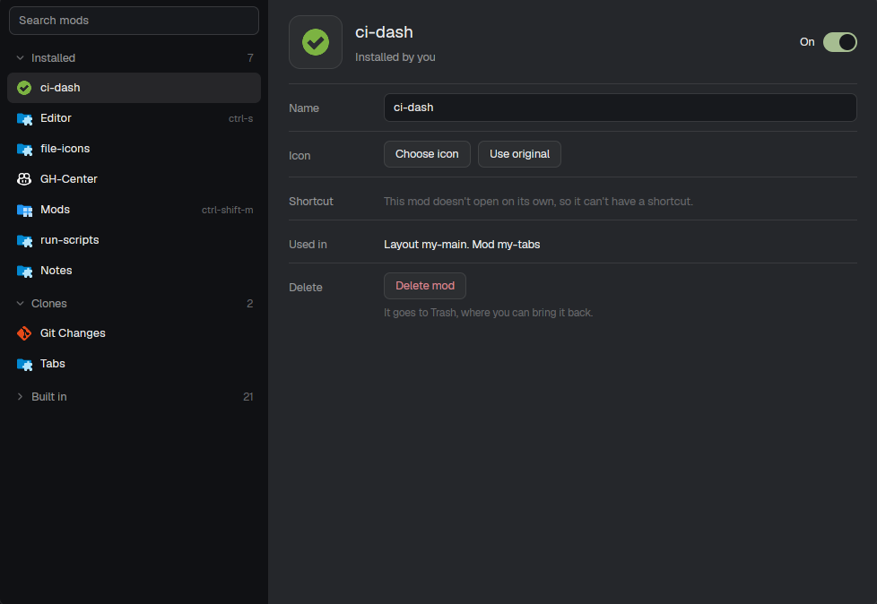

# Mod Manager

A dialog listing every Herdr mod, where you turn mods off and on, delete your own, and give any of them a name, an icon and a shortcut.

## What you see

A 980×680 dialog, `popover` background.

- **Left list**, 300px, `chrome`, `border` on the right. A search field (32px, `background`, `input` border, rounded 7) on top, then folding sections in this order: Installed, Clones, Trash, Built in (folded at first). Section header 32px: chevron, name (12.5px semibold `muted`), count (`dim`). Rows 34px: the mod's icon (18px, full color), its name, and its shortcut on the right in `dim` 11px, or "Off". Off mods are `dim` with the icon at 45% opacity. The selected row is `selected`.
- **Detail**, right, padded 22/20. A header: the icon in a 60px rounded tile (`raised`, `border`; click to change it), the name (19px semibold), what it is ("Installed by you", "Comes with Herdr", "Copy of <mod>"), and on the right an On/Off switch (38×22, `ansi2` when on). Mods Herdr needs (confirm, help, menu, prompt, toast…) and the manager itself show "Herdr needs it" / "Always on" instead.
  Below, rows split by `border` lines, labels 92px `muted`: Name (a field), Icon (Choose icon, Use original), Shortcut (a field and Save while changed, or why it can't have one), Used in (layouts and mods), Delete (red, installed mods only).
- **Icon picker** replaces the detail: Back, "Icon for <name>", a search field, and a 9-column grid of 58px tiles; the current one has an `accent` border.
- **Trash item**: Restore mod (primary) and Delete for good (red).
- **Bottom bar**: a confirmation (`blocked` top border, title, one line per consequence, Cancel and a red action), or the last message.

## How it behaves

- Turning off: takes the mod's blocks out of every personal layout (remembering parent, index and whether it was the active stack child) and its keys out of `keys.json`; an installed mod's folder also moves to `mod-manager/disabled/`. Turning on puts everything back and says what couldn't return. A mod used somewhere that isn't a block (a pane header, `terminal_menu`) can't be turned off.
- Delete: turns it off if needed, then moves the folder to `mod-manager/trash/<name>-<time>`. Restore turns it back on; Delete for good removes that folder.
- Name saves on Enter or leaving the field; empty goes back to the original. Icon saves on click.
- Shortcut: `mod.open:<name>` for overlay mods, `{command: "layout.toggle", args: {id}}` for a mod in a block outside a stack. A taken key asks first, naming who loses it; keys terminal programs need get their own warning. Keys compare in any modifier order.
- Every file change is written with `writeTextFile(path, next, raw)`; if `herdr-app status` reports more errors 1.2s later, the files are written back.
- One job at a time; the list is read again after each.

## Built from

- One mod, `mods/mod-manager/`: `main.js` (the view) and `model.js` (pure logic, testable with node: classify, layout references, remove and restore blocks, key normalizing, conflicts, shortcut actions, code references). `mod.json`: `{ "title": "Mods", "place": "none", "overlay": { "kind": "dialog", "width": 980, "height": 680 } }`. `keys.json`: `ctrl-shift-m` → `mod.open:mod-manager`.
- Built-in mods are the names in `installed.json` without `:`; shipped layouts the `layout:` ones. Clones have `cloned_from` in `mod.json`.
- Which mods use which: `grep -rEoH 'mods/[a-z0-9-]+|mod: *"…"|MOD = "…"'` over `mods/*.js`.
- herdr: `appHome`, `exec`, `readTextFile`, `writeTextFile`, `shared`/`setShared` (`mod-manager`: disabled and trash records; `mod-manager.labels`: names and icons), `theme`, `notify`.
- Art: 66 Material Icon Theme icons (MIT) in `icons/`.

## Watch out

- Editing `keys.json` makes Herdr stop updating its default keys for you.
- `layout.toggle` on a stack's child hides it instead of selecting it: don't use it there.
- Shipped layouts are replaced on every start, so the manager never edits them; a mod stays in those.
- `herdr-app check` renders without data, so it doesn't prove the list works: open the dialog.

## Done when

- Turning a mod off removes its block from your layout; turning it on puts it back in the same place.
- Deleting an installed mod moves its folder to `mod-manager/trash/`, and Restore brings it back working.
- Setting a taken shortcut lists the mod that loses it, and after confirming only one binding uses the key.
- A rename and an icon show in the list at once.
